# Bar-driven disc evolution


## Latest update — 02 November 2026, 20:35 IST (UTC+05:30)

**10,000-particle, live disc–halo–bulge validation completed; physical equilibrium remains unverified.** The updated Barnes–Hut solver now reads the softening length from the particle file, and its three fast regression tests pass. The full 300 Myr comparison reused **exactly the same AGAMA-generated particle positions and velocities** in all three runs, with no imposed bar.

| Diagnostic (0–300 Myr) | Baseline | Refined integration | Half softening |
|---|---:|---:|---:|
| Particle count | 10,000 | 10,000 | 10,000 |
| Integration timestep | 0.25 Myr | 0.125 Myr | 0.125 Myr |
| Tree opening angle | 0.50 | 0.35 | 0.35 |
| Exact total-energy drift | +0.2306% | **+0.0185%** | +0.2235% |
| Disc RMS-height change | +20.38% | +18.80% | +20.06% |
| Total angular-momentum drift | +0.0206% | +0.0106% | +0.0053% |
| 300 Myr equilibrium screen | **FAILED** | **FAILED** | **FAILED** |

**Interpretation:** Better time integration and tighter force calculation improve energy conservation substantially, but do **not** cure vertical thickening. The original finite-N Plummer accelerations differ from the smooth AGAMA reference by about **8% in median magnitude**, reflecting softening and finite-particle effects. The live model must not yet be interpreted as spontaneous bar formation or disc transformation.

### Latest live N-body snapshots and diagnostics

**Snapshots at 0, 150 and 300 Myr:** comparison of the baseline and reduced-softening simulations; the numerical solver evolves the live disc, halo and bulge.

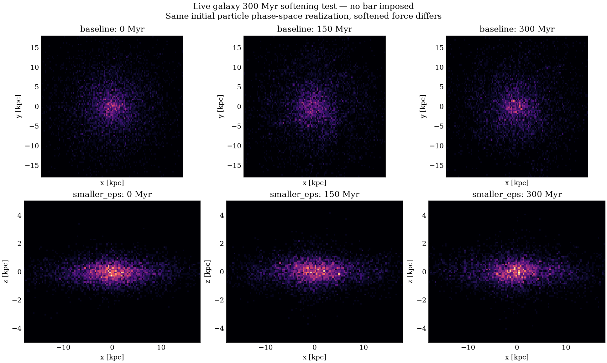

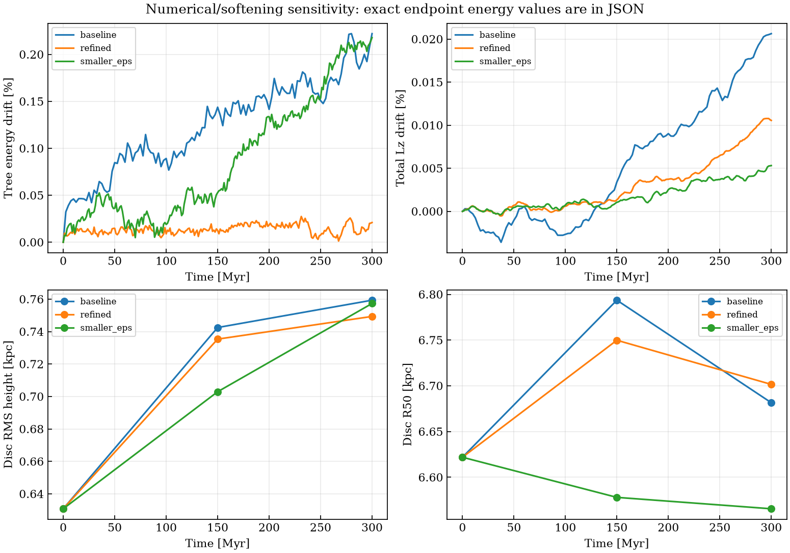

[Full force comparison and reproducible code](agama_fix/README.md) · [Measured validation JSON](agama_fix/results/fix_validation.json) · [Successful publication workflow](https://github.com/akhilkrishnar0/noguchi-bar-disc-simulation/actions/runs/41461330481)

### GIF animations — earlier controlled experiments

> **These GIFs are from the earlier 3,000-tracer fixed-potential tests (0–4.5 Gyr), not from the new live 10,000-particle simulations.** The rotating-bar GIF shows an **externally imposed** m=2 potential; neither animation demonstrates spontaneous bar formation.

| Unforced fixed-potential control | Externally imposed rotating m=2 control |
|---|---|
| 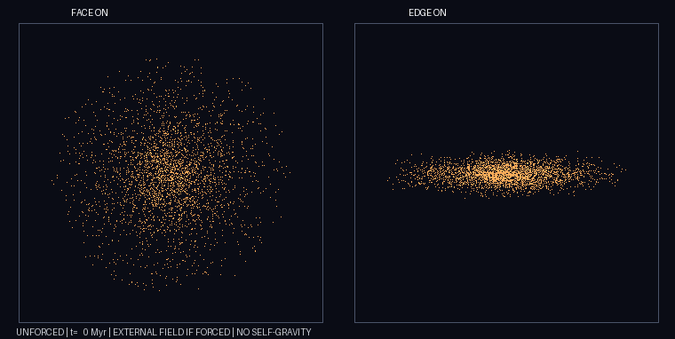 | 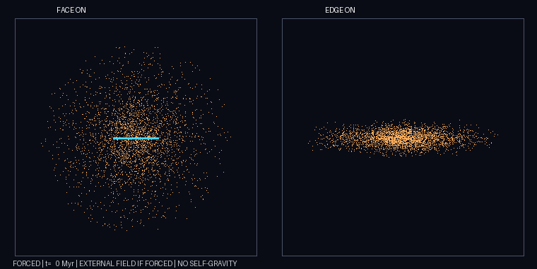 |

### Tracer surface-density and disc scale-length evolution

The plot below compares **both earlier fixed-potential control GIFs** using the actual tracer positions at every saved epoch (5 Myr cadence). The upper panel follows an exponential scale length fitted to the radial tracer surface-density profile between **1.5 and 9 kpc**, shown with a **105 Myr running mean**. The lower panel compares the radial profiles at **0, 2.25 and 4.5 Gyr**.

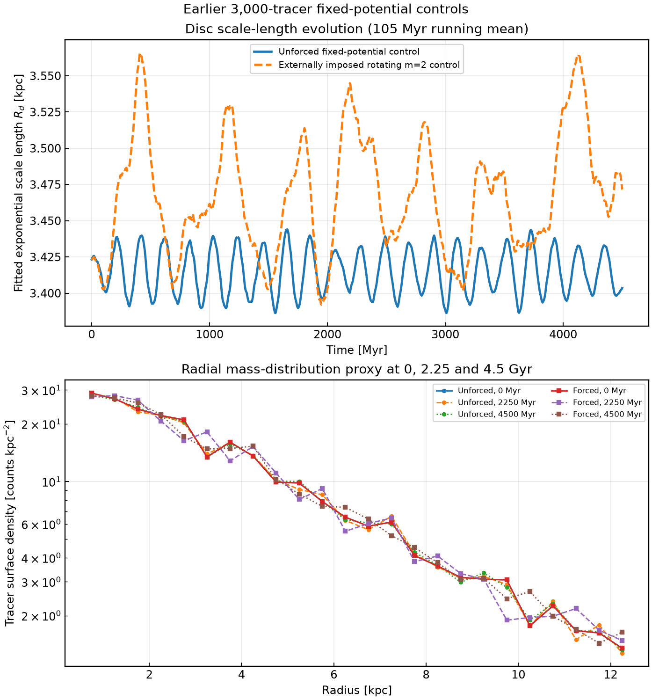

[Download unsmoothed 5 Myr scale-length measurements (CSV)](equilibrium_control/mass_scale_evolution.csv) · [Reproducible plotting script](equilibrium_control/mass_scale.py)

**Interpretation:** The unforced tracer profile remains nearly stationary; the externally driven control shows modest oscillations in the fitted scale length, without a demonstrated persistent disc expansion. **These particles have no self-gravity**, so their radial number density is only a **mass-distribution proxy**, not an actual live-galaxy stellar mass surface density. The imposed m=2 field is not a spontaneously formed bar.

The earlier **live 1,500-particle** unforced and imposed-bar GIFs, three-snapshot figure, and their failed-equilibrium caveats are **retained below**. All prior pilot results, documentation and plots remain unchanged.

---


### Live 10k galaxy: force/softening diagnosis

The AGAMA 300 Myr galaxy **failed** the initial short stationarity screen:
the stellar disc thickened by 20.38% and exact energy drifted by 0.231%.
A new controlled live study holds one AGAMA sampled phase-space realization
fixed while comparing original vs tighter integration and smaller
gravity softening. It includes an independent smooth-vs-direct gravitational
force comparison and reads actual per-component softening values in tree nodes.
**No improved physical equilibrium is claimed until the tests pass.**

[Diagnostic source, exact methodology and measured results](agama_fix/README.md)

---


### Next: 10,000-particle AGAMA-based live equilibrium trial (300 Myr)

A new, separately documented candidate starts from iterative action-based
disc, halo and bulge distribution functions generated by AGAMA, rather
than the previous approximate Gaussian/Jeans initializer. It integrates
a 10,000-particle *live* system for 300 Myr with 0.25 Myr steps, reporting
stationarity, energy, angular momentum and Q. The GitHub Actions test completed but **FAILED the physical equilibrium screen**:
+20.38% disc thickening and +0.231% exact energy drift in 300 Myr.
The scientific result is documented [here](agama_stage1/README.md),
including 0/150/300 Myr plots and machine-readable validation.

[Stage 1 source, validation criteria and outputs](agama_stage1/README.md)

---


### 2026-11-02: Equilibrium diagnosis and controlled repair

The prior 1,500-particle **self-gravitating** experiment still fails
vertical stationarity, numerical convergence and cross-platform reproducibility.
We have **not** claimed to fix that live galaxy model. Instead, an independent
**3,000-tracer, non-self-gravitating fixed-potential** comparison now passes
the 4.5 Gyr numerical stationarity and conservation checks and explicitly
tests an imposed rotating m=2 field. This separates integrator/bar-forcing
performance from the physically inconsistent live initial conditions.

[Validated fixed-potential control, code, GIFs and three epochs](equilibrium_control/README.md)

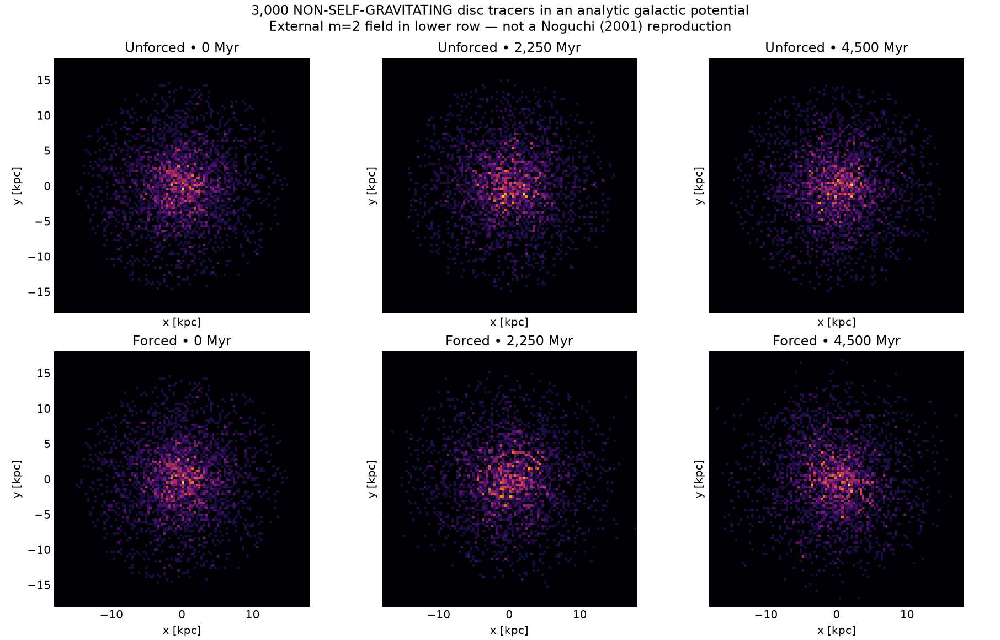

---

### NEW: Low-memory t=60 tests (equilibrium FAILED)

A separate **1,500-particle** exploratory setup completed the full **t=0–60** interval
(approximately **0–4.5 Gyr**) with **5 Myr saved epochs**. We generated an
unforced simulation and a separate **externally imposed rotating-bar** control.
The updated plots show **severe unphysical vertical thickening**; do not interpret
them as evidence of bar-driven GLSB formation. The original, higher-N pilot
below remains the historical baseline.

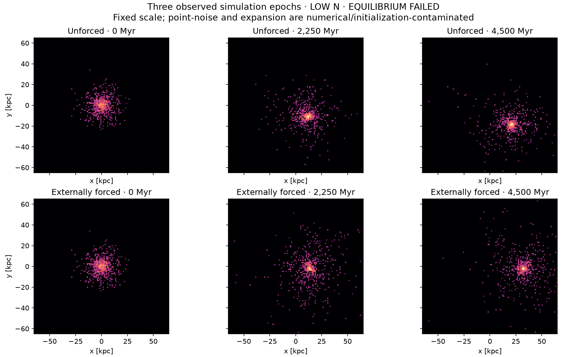

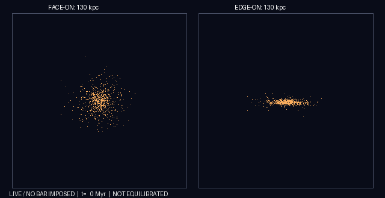
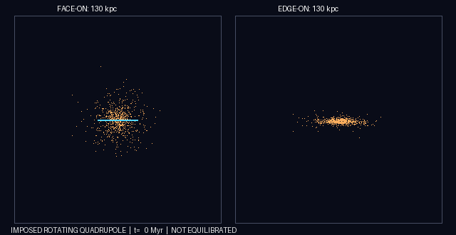

[Low-RAM source code, science caveats and numerical diagnostics](lowram/README.md)

---


### A reproducible N-body pilot inspired by Noguchi (2001)

**59,985 particles · live disc, halo and bulge · C++ / Python · numerical validation included**

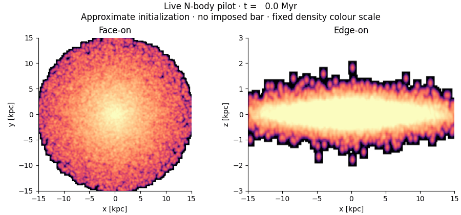

Can a stellar bar redistribute a bright disc into a more extended, lower-surface-density system? This repository starts with a collisionless experiment inspired by **Model A of Noguchi (2001)** and tests the numerical and equilibrium assumptions before attempting its long-term evolution.

> **Research status: equilibrium validation failed.** The numerical integrator passes the selected short-run conservation screen with tighter settings, but the starting galaxy is not sufficiently stationary. This is a documented reconstruction, not an exact reproduction of Noguchi's initial conditions and not evidence for giant-LSB formation.

[Results](#results) · [Run the experiment](#run-the-experiment) · [Scientific assumptions](docs/SCIENCE.md) · [Validation design](validation_run/VALIDATION_DESIGN.md) · [Roadmap](docs/ROADMAP.md)

## Results

The initial pilot and both full-length validation cases cover **one code time unit**, approximately **75 Myr** under the paper's illustrative scaling. No bar is imposed. The smaller-timestep validation covers only 18.75 Myr.

| Measurement | Initial | Live, tighter forces | Frozen initial field |
|---|---:|---:|---:|
| Disc half-mass radius [kpc] | 5.763 | 5.746 | 5.818 |
| Disc RMS height [kpc] | 0.273 | 0.325 | 0.322 |
| Global A₂, 0.75–9 kpc | 0.0029 | 0.0307 | 0.0063 |
| Exact endpoint energy drift | — | +0.0111% | +0.0067% |

The frozen-field energy is the orbital energy in an imposed static potential; its definition differs from the live system's self-gravitating total energy. The tests use identical initial particle states.

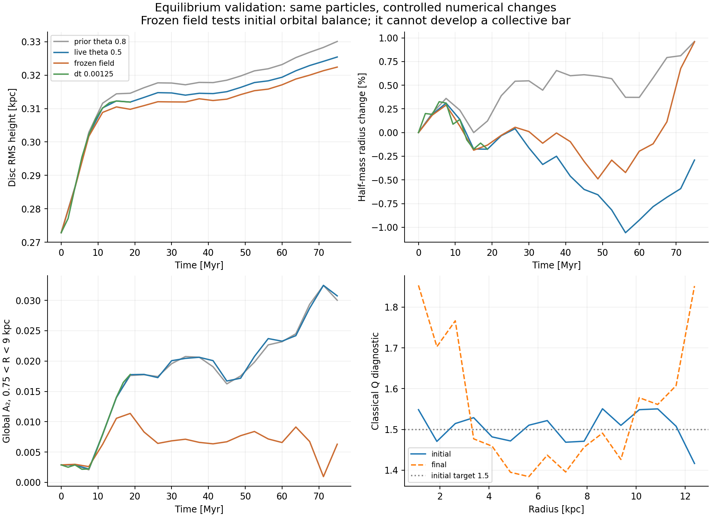

**What this tells us**

- Vertical thickening persists when collective gravitational response is disabled. Together with excess initial vertical kinetic support, this identifies an initialization imbalance as a major contributor.
- The live case has stronger twofold structure than the frozen-field control. This is consistent with a collective response, but does not establish a persistent bar.
- The sign of the small half-mass-radius change differs between tree opening angles 0.8 and 0.5. The earlier ~1% expansion is not a converged physical result.
- Halving the tighter run's timestep again gives very similar structural diagnostics through t=0.25. Full-duration timestep convergence and longer-term stability remain untested.
- Noguchi's illustrated endpoint is t=60. These t≤1 experiments do not test the reported long-term disc transformation.

See [machine-readable validation results](validation_run/validation_results.json), the [validation report](docs/VALIDATION.md), and the [original pilot report](noguchi_pilot/README.md).

## Run the experiment

Requirements: Linux or a compatible Unix environment, Python 3.10+, a C++17 compiler, and OpenMP. Commands below use GCC. No GPU is required.

```bash
python3 -m venv .venv
source .venv/bin/activate
python3 -m pip install -r requirements.txt

# Original pilot, timestep comparison, plots and animation
bash noguchi_pilot/run.sh

# Tighter-force, shorter-timestep and frozen-field validation
bash validation_run/run_validation.sh

# Small analytical-orbit regression tests (no full galaxy simulation)
python3 -m unittest discover -s tests -v
```

The full experiments are CPU workloads. Runtime depends strongly on hardware and tree accuracy; allow minutes to tens of minutes for the included short runs. Do not infer a t=60 runtime from these numbers without a new benchmark. `OMP_NUM_THREADS=4` is the default; override it to fit your machine.

Scripts regenerate ignored particle snapshots locally. Running a suite replaces that suite's generated files; archive any run you want to preserve first. Summary CSV/JSON and figures are committed so the scientific conclusions can be inspected without running the simulation. Original particle files can be regenerated using the recorded seed; identical results across different compilers and library versions are not guaranteed.

## What is matched—and what is assumed

| Published Model A settings retained | Reconstruction choices |
|---|---|
| Disc / halo / bulge masses: 0.6 / 0.2 / 0.2 | Assumed, tapered Hernquist-shaped halo |
| Particle counts: 30,000 / 10,000 / 19,985 | Assumed disc vertical profile and thickness |
| Disc scalelength 0.25; bulge effective radius 0.05 | Approximate Jeans velocity initialization |
| Softening lengths: 0.02 / 0.04 / 0.004 | Symmetric Plummer pair-softening rule |
| Initial radial Q target 1.5 | No staged halo/bulge relaxation |

The original relaxation sequence and Figure 1 profiles have **not** been reproduced. The missing equilibrium preparation is a central limitation, not a minor implementation detail. The full assumptions are in [SCIENCE.md](docs/SCIENCE.md).

## Repository guide

| Location | Contents |
|---|---|
| `noguchi_pilot/` | Initialization, original octree solver, exact energy checks, first-run outputs |
| `validation_run/` | Live/frozen solver, direct ring-force probes, validation suite and outputs |
| `docs/` | Scientific interpretation, limitations and next steps |
| `tests/` | Small numerical regression tests |

Snapshots use float64 rows `[x, y, z, vx, vy, vz, mass, softening, component]`; component IDs 0, 1, 2 denote disc, halo, bulge. Full data-format details are in the pilot report.

## Reference and attribution

Noguchi, M. (2001), *Formation of giant low surface brightness galaxies through disc instability*, MNRAS **328**, 353–358. [doi:10.1046/j.1365-8711.2001.04910.x](https://doi.org/10.1046/j.1365-8711.2001.04910.x).

Project maintained by **Akhil Krishna R**. Code and initial analyses were developed with assistance from OpenAI ChatGPT/Codex. This is an independent implementation, not the author's original simulation code. The journal PDF is not redistributed here. See [CITATION.cff](CITATION.cff).
