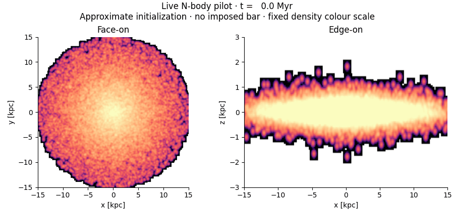
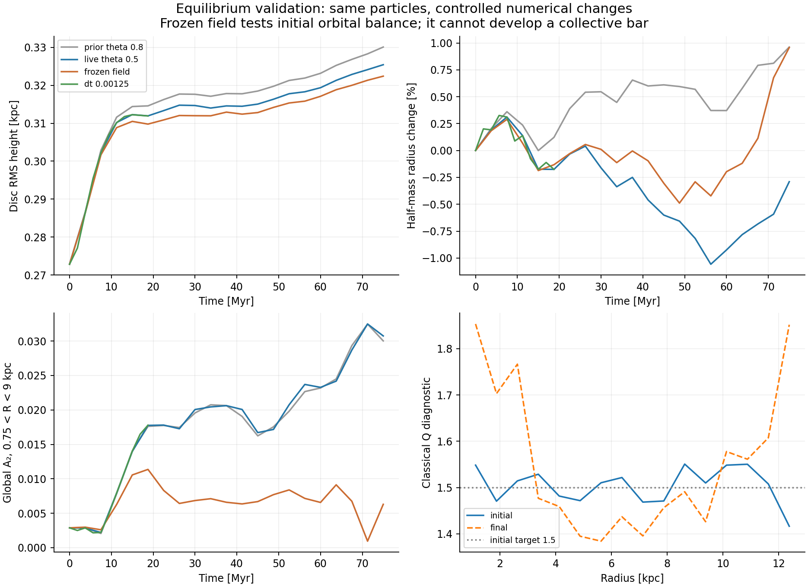

# Bar-driven disc evolution

### A reproducible N-body pilot inspired by Noguchi (2001)

**59,985 particles · live disc, halo and bulge · C++ / Python · numerical validation included**



Can a stellar bar redistribute a bright disc into a more extended, lower-surface-density system? This repository starts with a collisionless experiment inspired by **Model A of Noguchi (2001)** and tests the numerical and equilibrium assumptions before attempting its long-term evolution.

> **Research status: equilibrium validation failed.** The numerical integrator passes the selected short-run conservation screen with tighter settings, but the starting galaxy is not sufficiently stationary. This is a documented reconstruction, not an exact reproduction of Noguchi's initial conditions and not evidence for giant-LSB formation.

[Results](#results) · [Run the experiment](#run-the-experiment) · [Scientific assumptions](docs/SCIENCE.md) · [Validation design](validation_run/VALIDATION_DESIGN.md) · [Roadmap](docs/ROADMAP.md)

## Results

The initial pilot and both full-length validation cases cover **one code time unit**, approximately **75 Myr** under the paper's illustrative scaling. No bar is imposed. The smaller-timestep validation covers only 18.75 Myr.

| Measurement | Initial | Live, tighter forces | Frozen initial field |
|---|---:|---:|---:|
| Disc half-mass radius [kpc] | 5.763 | 5.746 | 5.818 |
| Disc RMS height [kpc] | 0.273 | 0.325 | 0.322 |
| Global A₂, 0.75–9 kpc | 0.0029 | 0.0307 | 0.0063 |
| Exact endpoint energy drift | — | +0.0111% | +0.0067% |

The frozen-field energy is the orbital energy in an imposed static potential; its definition differs from the live system's self-gravitating total energy. The tests use identical initial particle states.



**What this tells us**

- Vertical thickening persists when collective gravitational response is disabled. Together with excess initial vertical kinetic support, this identifies an initialization imbalance as a major contributor.
- The live case has stronger twofold structure than the frozen-field control. This is consistent with a collective response, but does not establish a persistent bar.
- The sign of the small half-mass-radius change differs between tree opening angles 0.8 and 0.5. The earlier ~1% expansion is not a converged physical result.
- Halving the tighter run's timestep again gives very similar structural diagnostics through t=0.25. Full-duration timestep convergence and longer-term stability remain untested.
- Noguchi's illustrated endpoint is t=60. These t≤1 experiments do not test the reported long-term disc transformation.

See [machine-readable validation results](validation_run/validation_results.json), the [validation report](docs/VALIDATION.md), and the [original pilot report](noguchi_pilot/README.md).

## Run the experiment

Requirements: Linux or a compatible Unix environment, Python 3.10+, a C++17 compiler, and OpenMP. Commands below use GCC. No GPU is required.

```bash
python3 -m venv .venv
source .venv/bin/activate
python3 -m pip install -r requirements.txt

# Original pilot, timestep comparison, plots and animation
bash noguchi_pilot/run.sh

# Tighter-force, shorter-timestep and frozen-field validation
bash validation_run/run_validation.sh

# Small analytical-orbit regression tests (no full galaxy simulation)
python3 -m unittest discover -s tests -v
```

The full experiments are CPU workloads. Runtime depends strongly on hardware and tree accuracy; allow minutes to tens of minutes for the included short runs. Do not infer a t=60 runtime from these numbers without a new benchmark. `OMP_NUM_THREADS=4` is the default; override it to fit your machine.

Scripts regenerate ignored particle snapshots locally. Running a suite replaces that suite's generated files; archive any run you want to preserve first. Summary CSV/JSON and figures are committed so the scientific conclusions can be inspected without running the simulation. Original particle files can be regenerated using the recorded seed; identical results across different compilers and library versions are not guaranteed.

## What is matched—and what is assumed

| Published Model A settings retained | Reconstruction choices |
|---|---|
| Disc / halo / bulge masses: 0.6 / 0.2 / 0.2 | Assumed, tapered Hernquist-shaped halo |
| Particle counts: 30,000 / 10,000 / 19,985 | Assumed disc vertical profile and thickness |
| Disc scalelength 0.25; bulge effective radius 0.05 | Approximate Jeans velocity initialization |
| Softening lengths: 0.02 / 0.04 / 0.004 | Symmetric Plummer pair-softening rule |
| Initial radial Q target 1.5 | No staged halo/bulge relaxation |

The original relaxation sequence and Figure 1 profiles have **not** been reproduced. The missing equilibrium preparation is a central limitation, not a minor implementation detail. The full assumptions are in [SCIENCE.md](docs/SCIENCE.md).

## Repository guide

| Location | Contents |
|---|---|
| `noguchi_pilot/` | Initialization, original octree solver, exact energy checks, first-run outputs |
| `validation_run/` | Live/frozen solver, direct ring-force probes, validation suite and outputs |
| `docs/` | Scientific interpretation, limitations and next steps |
| `tests/` | Small numerical regression tests |

Snapshots use float64 rows `[x, y, z, vx, vy, vz, mass, softening, component]`; component IDs 0, 1, 2 denote disc, halo, bulge. Full data-format details are in the pilot report.

## Reference and attribution

Noguchi, M. (2001), *Formation of giant low surface brightness galaxies through disc instability*, MNRAS **328**, 353–358. [doi:10.1046/j.1365-8711.2001.04910.x](https://doi.org/10.1046/j.1365-8711.2001.04910.x).

Project maintained by **Akhil Krishna R**. Code and initial analyses were developed with assistance from OpenAI ChatGPT/Codex. This is an independent implementation, not the author's original simulation code. The journal PDF is not redistributed here. See [CITATION.cff](CITATION.cff).
