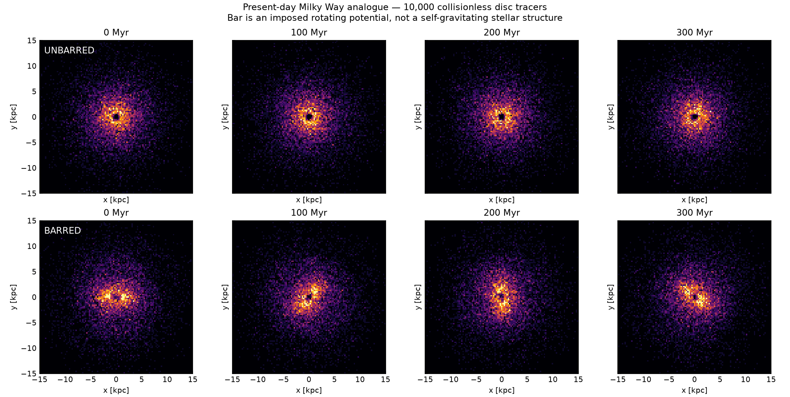
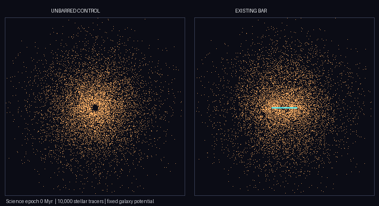
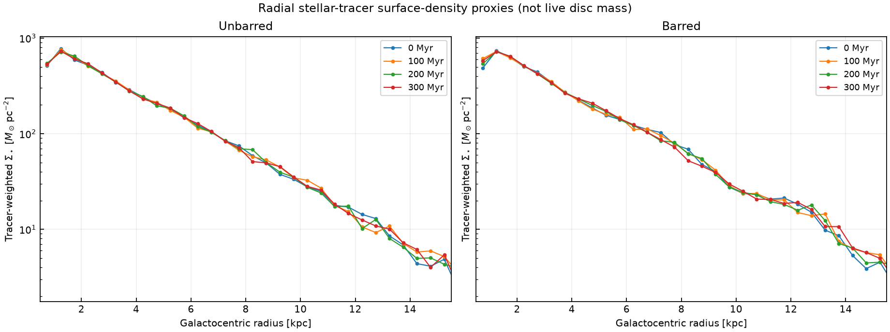
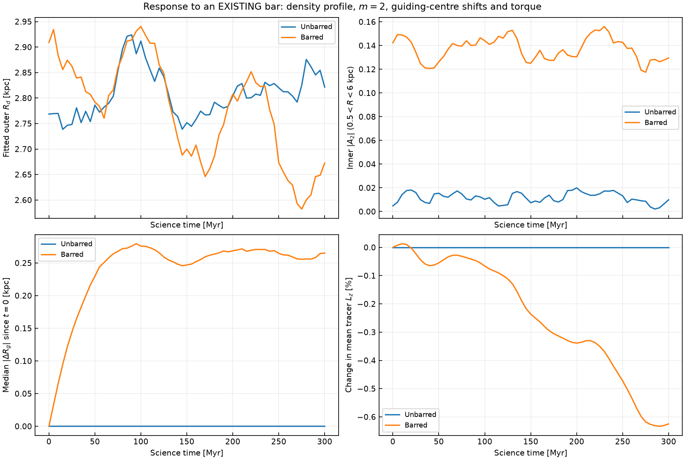
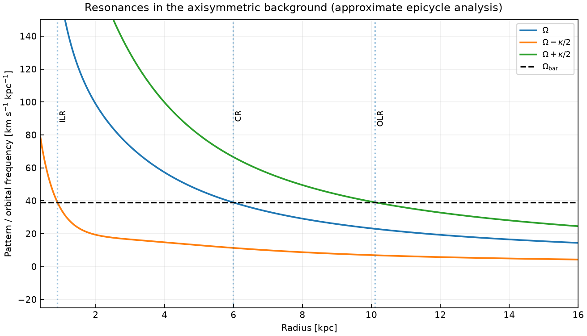

# Milky Way Bar Dynamics — Version 2

**A present-day Milky Way-like disc at redshift z ~ 0, with an existing rotating bar.** The goal is to measure **how that bar changes stellar orbits, guiding-centre radii, angular momentum, and tracer surface-density profiles**. We do **not** model bar formation.

**Restarted: 6 November 2026.** All previous simulations, code, scientific caveats, figures and GIFs were preserved unchanged in [the `legacy/v1-2026-11-06` branch](../../tree/legacy/v1-2026-11-06) at [commit `643909d`](../../commit/643909d6481723a9227a3aa9e88fe799064819ae). Historical commits also remain in Git history.

## Model

| Property | Adopted baseline |
|---|---|
| Galactic epoch | z ~ 0; no cosmological evolution |
| Disc gravity | Miyamoto-Nagai potential; stellar mass 5.3 x 10^10 Msun; a = 2.75 kpc, b = 0.30 kpc |
| Bulge gravity | Hernquist potential; 8 x 10^9 Msun; a = 0.55 kpc |
| Halo gravity | NFW potential, normalized to V_c(8.2 kpc) = 232.8 km/s; nominal virial mass 1.39 x 10^12 Msun |
| Existing stellar bar | External rotating 3D m=2 quadrupole; reference bar length 4.8 kpc (no hard truncation) |
| Bar speed | Constant 39 km/s/kpc; bar-period ~157.5 Myr |
| Bar strength | Peak tangential-force fraction 0.12 over 1-6 kpc |
| Stellar particles | **10,000 massless orbit tracers**, equal weights for surface-density proxies |
| Tracer initial conditions | Approximate epicycle distribution, radial scalelength 2.6 kpc |
| Pre-science evolution | 500 Myr: smoothly establish bar over 300 Myr, then settle 200 Myr |
| **Science duration** | **0-300 Myr with the full-strength bar already present at t = 0** |
| Numerical time step / output | **0.25 Myr** integration; snapshots every **5 Myr** |
| Baseline comparison | Identical particle IDs at **t = -500 Myr**, evolved with/without the prescribed bar |

The axisymmetric model is anchored to observational solar-radius benchmarks (McMillan 2017), and the fiducial bar pattern speed follows Portail et al. (2017). Other parameters and the effective quadrupole are **illustrative**, not a best-fitting 3D Milky Way mass model. The reference bar length is not a hard dynamical truncation of the quadrupole.

### Existing bar, not bar formation

The barred and unbarred runs begin from the **same catalogue 500 Myr before science t = 0**. In the barred run, bar strength grows smoothly from t = -500 to -200 Myr, then remains fully established. The science interval starts at t = 0 after 200 Myr at the full bar strength. This models response to an **existing bar**, not the physical formation of one. The two samples differ in phase space at science t = 0, although their particle identities and original phase-space samples are matched at t = -500 Myr.

## Measured simulation figures











All figures and animations are generated from the numerical integrations; they are not artistic/AI illustrations. The cyan line in the GIF is the **externally imposed bar potential orientation**.

### Numerical results of the first 10,000-tracer run

| Diagnostic (0-300 Myr) | Unbarred control | Existing-bar model |
|---|---:|---:|
| Half-number radius change | +0.59% | -0.98% |
| Disc RMS thickness change | -0.07% | -2.14% |
| Fitted outer disc scale length at t = 0 | 2.77 kpc | 2.91 kpc |
| Fitted outer disc scale length at t = 300 | 2.82 kpc | 2.67 kpc |
| Inner A2 at t = 300 | 0.010 | 0.129 |
| Median absolute guiding-radius change after 300 Myr | ~0 kpc | 0.265 kpc |
| Fraction with |Delta Rg| > 0.5 kpc | ~0% | 31.0% |
| Maximum relative drift of mean conserved quantity | 1.7e-7 (energy) | 1.5e-6 (Jacobi integral) |

The outer scale length is fitted to the **4-11 kpc** range; its change is a *tracer density proxy*, not a self-consistent stellar-mass redistribution result. Guiding radii are inferred from the axisymmetric background and become approximate in strongly barred regions. The 300 Myr results show stellar orbital response and torques, **not secular bar formation or long-term disc growth**.

[Simulation summary and validity checks](results/summary.json) | [Barred time-series](results/barred_diagnostics.csv) | [Unbarred time-series](results/unbarred_diagnostics.csv)

## Run

Python 3.10+, CPU only. The example creates 61 snapshots per case (5 Myr spacing):

```bash
python -m pip install -e .
python -m unittest discover -s tests -v
python -m mwbar.run --n 10000 --dt 0.25 --end 300 --warmup 500 --growth 300 --snapshot 5 --seed 2026 --out results
```

The script also supports smaller quick experiments through `--n`, `--end`, `--warmup`, and `--growth` parameters. Full tracer histories (`results/barred_orbits.npz` and `results/unbarred_orbits.npz`) are not committed; the GitHub Actions workflow publishes figures/CSV/JSON and offers those histories as a downloadable workflow artifact.

## Numerical validation and limitations

The tests verify the 3D gravitational accelerations against finite differences of the potential; solar-radius circular speed; nonaxisymmetric force; smooth bar activation; ordering of resonances; timestep-halving; orbital conservation; and snapshot cadence. In the unbarred potential, inertial energy and Lz should be conserved. In the fully established rotating-bar potential, the conserved quantity is the **Jacobi integral E - Omega_bar * Lz**, not energy or Lz separately. The model checks numerical drift and the unbarred control's approximate structural stationarity.

**Important limitations:** Tracer particles do not self-gravitate. The disc, halo, and bulge potentials are fixed. The external m=2 quadrupole is **not** a full 3D Ferrers-density bar and does not respond to stellar torques. The initial epicycle distribution is approximate rather than an exact self-consistent action DF. There is **no live-halo resonance absorption, bar slowdown, gas, star formation, or feedback**. Measured tracer-weighted surface density and guiding-radius shifts must not be interpreted as a complete galaxy-evolution model. Additional bar-strength, pattern-speed, tracer-count, initial-DF and duration tests are required for scientific convergence.

## Project layout

| Path | Role |
|---|---|
| `mwbar/model.py` | 3D Miyamoto-Nagai, Hernquist and NFW forces; rotating quadrupole |
| `mwbar/initial.py` | Approximate epicyclic stellar orbit population |
| `mwbar/integrate.py` | Smooth pre-science bar preparation and leapfrog integration |
| `mwbar/measure.py` | Density profiles, Rd, guiding radii, inner A2 and invariants |
| `mwbar/plots.py` | Scientific figures and true-orbit animated GIF |
| `mwbar/run.py` | Full reproducible experiment |
| `tests/` | Force, resonance and numerical checks |
| `results/` | Published measurements and figures from GitHub Actions |
| [`legacy/v1-2026-11-06`](../../tree/legacy/v1-2026-11-06) | The entire earlier version, **unchanged** |

## References

- McMillan (2017), *The mass distribution and gravitational potential of the Milky Way*. [DOI](https://doi.org/10.1093/mnras/stw2759).
- Portail et al. (2017), *Dynamical modelling of the Galactic bulge and bar*. [DOI](https://doi.org/10.1093/mnras/stw2819).
- Athanassoula (2003), *What determines the strength and the slowdown rate of bars?* [DOI](https://doi.org/10.1046/j.1365-8711.2003.06473.x). **Live-halo physics in that work is not reproduced here.**
- Noguchi (2001), *Formation of giant low surface brightness galaxies through disc instability*. [DOI](https://doi.org/10.1046/j.1365-8711.2001.04910.x). **Bar formation in that work is not reproduced here.**

Project maintained by Akhil Krishna R. Simulation implementation and preliminary numerical analysis assisted by OpenAI ChatGPT.