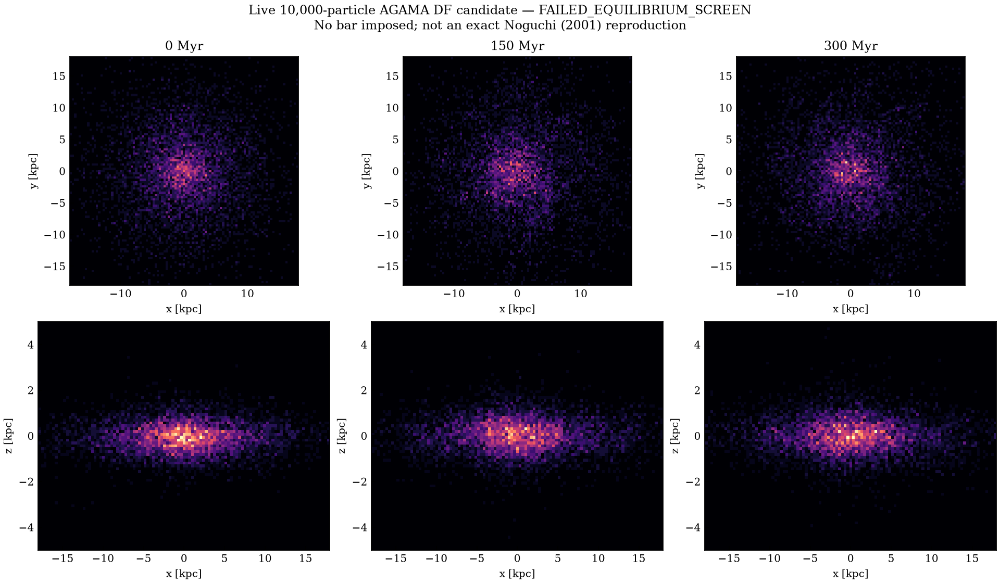
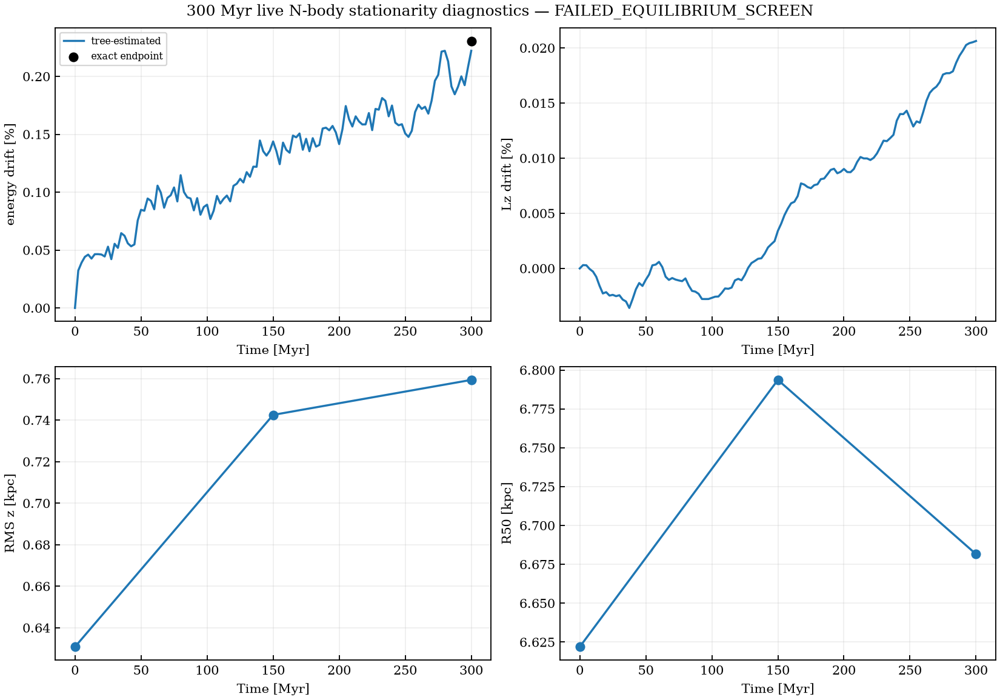
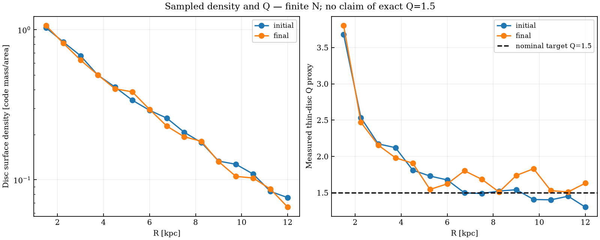

# Stage 1: 300 Myr live N-body equilibrium test

## Executed result (2026-11-02)

**GitHub Actions execution succeeded, but the scientific equilibrium screen FAILED.**
The following values come from measured simulation outputs, not an illustration:

| Diagnostic (300 Myr) | Measured | Gate |
|---|---:|---|
| Initial disc median Q | 1.703 | 1–2.5 (pass) |
| Disc RMS height change | +20.384% | <5% (FAIL) |
| Disc half-mass radius change | +0.901% | <2% (pass) |
| Exact endpoint energy change | +0.2306% | <0.1% (FAIL) |
| Total Lz change | +0.02063% | <0.05% (pass) |
| Initial A2 | 0.01257 | bar not established |
| Final A2 | 0.01283 | bar not established |

[Machine-readable full validation result](results/validation.json)

The action-DF model does **not** pass live numerical equilibrium even though
its smooth analytic DF iteration converged in mass. It is incorrect to say
that we have fixed vertical equilibrium. The measured evolution is consistent
with several still-unresolved effects: a mismatch between smooth DF potential
and discrete Plummer-softened forces, limited particle number, and/or numerical
force/timestep error. The data do not uniquely isolate their relative roles.
Before a 4.5 Gyr bar run, compare exact direct forces against the sampled
AGAMA potential in the initial state and repeat with finer timestep/tree
accuracy, consistent softening, and larger particle numbers.

This experiment samples iterative self-consistent action-based distribution
functions with [AGAMA](https://github.com/GalacticDynamics-Oxford/Agama):
6,000 live disc, 2,000 live dark halo, and 2,000 live bulge particles.
It evolves 300 Myr without imposing a bar, with an internal integration
step of 0.25 Myr and snapshots every 5 Myr. The official AGAMA
example_self_consistent_model_bdh.py is the method reference.

**This is NOT an exact Noguchi (2001) Model A reproduction.**
The 0.6/0.2/0.2 component masses, disc scalelength 0.25 and bulge
Re=0.05 are targets, but the halo and truncation are independently assumed.
AGAMA uses a smooth potential for the DF, while the live N-body solver
uses softened gravity with epsilon=0.02,0.04,0.004 for the disc, halo and bulge.
This potential mismatch is a limitation that must be tested.

Outputs: exact endpoint pairwise energy, Lz drift, disc RMS thickness,
R50, radial surface density, Q profile, and m=2 structure with 0, 150
and 300 Myr figures. A machine-readable validation.json reports PASS/FAIL.
The exploratory gates are under 5% change in disc height, under 2% in R50,
under 0.1% exact energy error, under 0.05% Lz change, and sampled median Q
between 1 and 2.5 (nominal target Q=1.5).

## Run

Requires Linux, GCC, GSL, Eigen, numpy, scipy, matplotlib and AGAMA.

    sudo apt-get install -y libgsl-dev libeigen3-dev
    python -m pip install -r requirements.txt setuptools wheel
    python -m pip install agama --no-build-isolation
    bash agama_stage1/run.sh

GitHub Actions executes the actual experiment and commits only *measured*
outputs. Failures and unfinished tests are not presented as successes.

If this short screen passes, the next work is force-softening, timestep,
particle-number and seed convergence, then multi-orbit stationarity and
spontaneous bar dynamics. No conclusions about GLSB formation can be made
from a 300 Myr equilibrium screen.

Reference: Noguchi (2001), MNRAS 328, 353.
https://doi.org/10.1046/j.1365-8711.2001.04910.x
