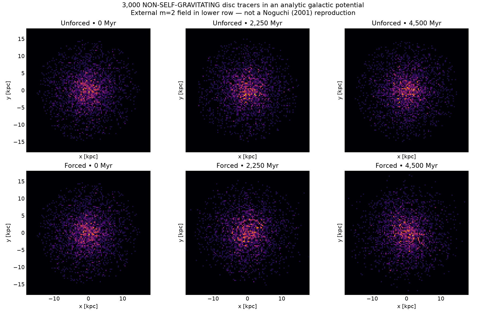
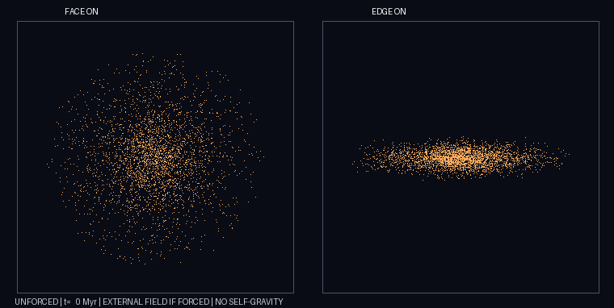
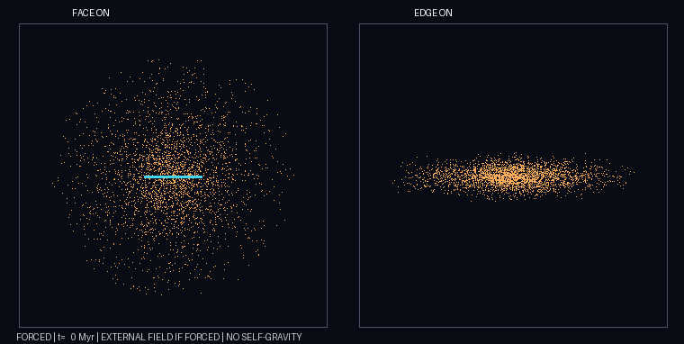
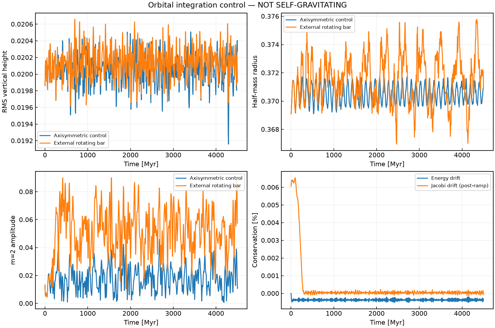
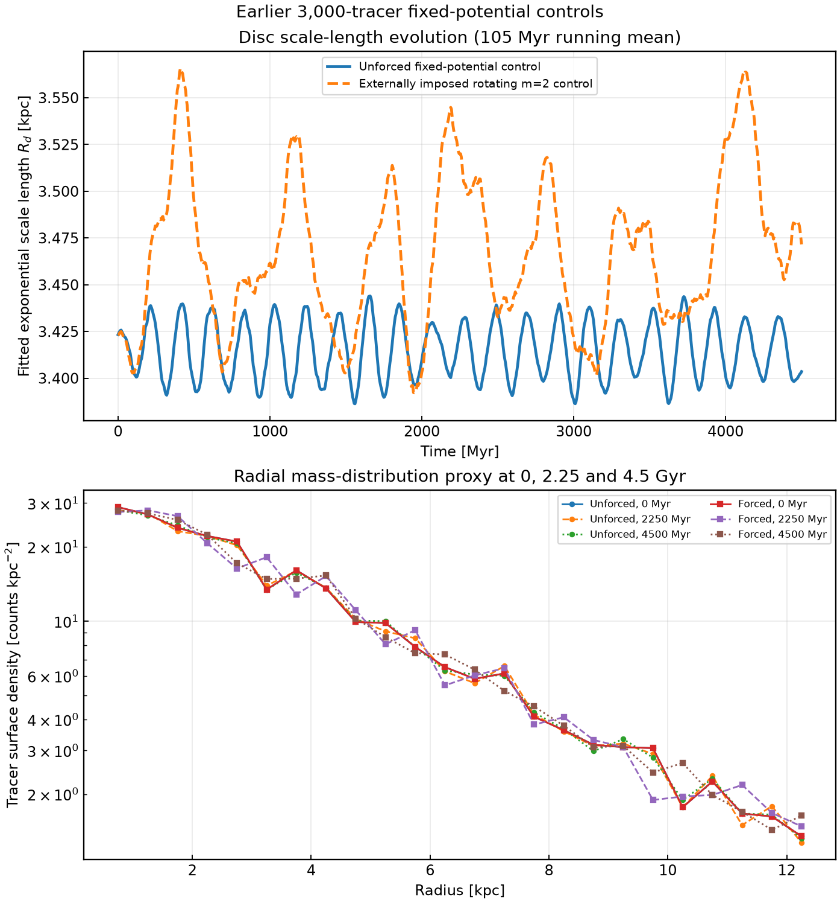

# Numerically stable fixed-potential control

This is a **test-particle orbit experiment**, not a self-gravitating simulation or
Noguchi (2001) Model A reproduction. It isolates integrator errors from the
bad equilibrium and low-N stochasticity documented in ../lowram.

**Components:** 3,000 massless rotating disc tracers in fixed
Miyamoto-Nagai disc plus two spherical Plummer (halo/bulge) potentials.
The disc is prepared with midplane circular velocities and small-amplitude
vertical epicycle phases. This is a near-stationary controlled approximation,
not an exact finite-thickness 3D distribution function.

**Times:** 0–4,500 Myr (t=0–60), leapfrog integration step 1 Myr,
901 outputs separated by 5 Myr; GIF displays every 50 Myr. The forced
experiment additionally imposes a smoothly activated rotating m=2
quadrupole; it does not grow a bar spontaneously.

The figure uses **901 stored tracer snapshots** at 5 Myr intervals. The fitted
exponential length uses annuli at radii 1.5–9 kpc, and the displayed length
curves are 105 Myr running means. The lower panel shows the surface-number-density
profiles at 0, 2.25 and 4.5 Gyr. This is an **equal-weight tracer-number-density
proxy**, *not self-gravitating mass redistribution*. Differences in the forced
case arise in an externally imposed rotating m=2 potential, not a live stellar bar.

[Per-snapshot unsmoothed scale lengths (CSV)](mass_scale_evolution.csv) ·
[Plotting source](mass_scale.py)

## Measured independent control runs (seed 2001)

| Metric after 4.5 Gyr | Unforced | External rotating m=2 |
|---|---:|---:|
| Vertical RMS height change | +2.08% | +0.22% |
| Disc half-mass radius change | +0.51% | +0.50% |
| Specific-energy change | -0.00032% | Not conserved (external work) |
| Lz change | 0.0% | +0.12% external torque |
| Final global A2 | 0.011 | 0.057 |
| Maximum Jacobi fractional drift after ramp | n/a | 2.3e-6 |

Two other random seeds yielded +3.82% and +1.24% disc-height changes after
4.5 Gyr in the unforced control. Finite-difference force gradients,
energy, angular momentum, Jacobi invariant and timestep-halving checks pass.

## Reproduce

From project root:

    pip install -r requirements.txt
    python -m unittest discover -s equilibrium_control -p test_control.py -v
    python equilibrium_control/control.py --out equilibrium_control/results/unforced
    python equilibrium_control/control.py --forced --out equilibrium_control/results/forced
    python equilibrium_control/render.py

All 901 particle snapshots are saved into a compressed NPZ file locally,
and summary CSV/JSON is preserved on GitHub. The plots are fixed-scale.
The cyan marker in the forced GIF identifies the imposed potential orientation,
not a measured stellar bar.

## Outstanding problem

**The original self-gravitating model remains unvalidated.** Its approximate
initial velocities were not a steady distribution function; its low-N live
evolution suffered large thickness changes, poor long-term conservation, and
large variation between independent runs. The new analytic control proves that
the orbit integrator and external quadrupole can behave properly without
collective self-gravity; it is not a repair for live disc/halo/bulge equilibrium.

For physical replication of Noguchi (2001), construct a self-consistent
collisionless distribution function for all live components; reproduce the
halo/bulge preparation and density/rotation/Q profiles; and demonstrate
multi-orbit stationarity, dt/softening/tree/N/seed convergence before claiming
spontaneous bar evolution or bar-driven disc-profile flattening.

Sources: Noguchi (2001),
https://doi.org/10.1046/j.1365-8711.2001.04910.x .
Sellwood & Debattista (2009), MNRAS 398, 1279, stochastic N-body evolution.
