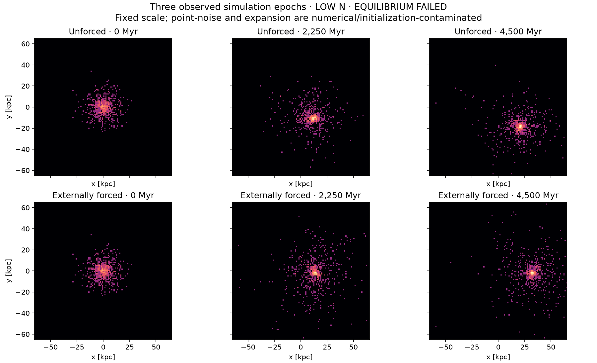
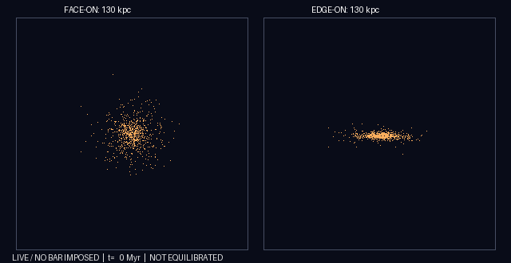
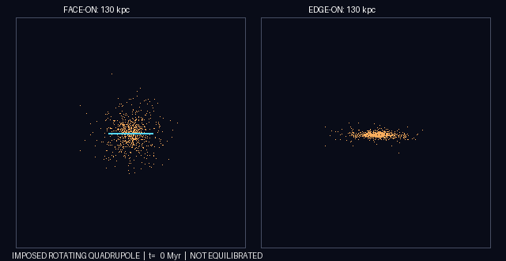
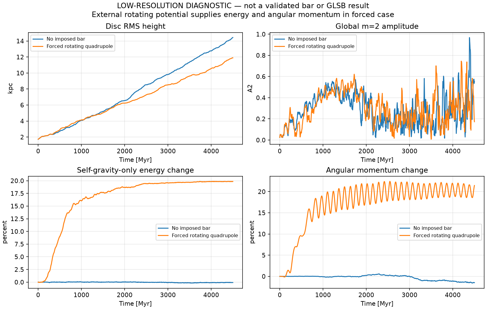

# Low-RAM exploratory t=60 experiment — equilibrium FAILED

This folder contains a separate demonstration, not a scientific replacement for the
59,985-particle pilot. This is a **new approximate model**, not Noguchi (2001) Model A.

The two live-body runs completed from t=0 to 60, approximately **0 to 4,500 Myr**
under the illustrative 75 Myr/code-time conversion. **Integration dt=1 Myr**;
**snapshot spacing=5 Myr**; 901 output epochs in each run.
Five Myr is not used as the numerical integration step.

## Three snapshots and animations

The cyan line in the external-field GIF denotes the imposed quadrupole orientation.
It is NOT evidence for a measured stellar bar.

## Reproduce

~~~sh
python3 -m pip install -r requirements.txt
bash lowram/run.sh
~~~

Run from the repository root, with g++ (C++17/OpenMP), Python, NumPy,
Matplotlib and Pillow. It uses 1,500 particles (750 disc, 300 halo, 450 bulge);
the two sets of 901 snapshots require ~200 MB **disk**, but only modest RAM.
Binary snapshots are regenerated and ignored by Git. The workflow commits
only summary CSV/JSON and GIF/PNG outputs.

## Dynamics

- Mass fractions are disc/halo/bulge = 0.6/0.2/0.2. Their spatial profiles,
  softening (0.05/0.08/0.04), velocity initializer and spheroid truncation
  are **approximate assumptions**, not a reconstruction of Noguchi (2001).
- Stage 1 holds disc and bulge fixed/inactive while the live halo relaxes for
  15.6 code units. Stage 2 evolves halo+bulge with fixed disc for 4 code units.
  This approximates, but does not exactly recreate, the published staged setup.
- Disc receives two live phase-mixing warm-ups with azimuthal angle mixing
  and radial-bin vertical-virial velocity recalibration. An instantaneous
  virial moment is not an equilibrium distribution function.
- The forced experiment uses a smoothly activated externally imposed rotating
  m=2 quadrupole (strength 0.024, scale 0.22, pattern speed 1.8 code units).
  It injects energy and angular momentum; total live Lz and self-gravity-only
  energy need not be conserved in that controlled experiment.

## Measured scientific limits

| Diagnostic | Unforced | Imposed m=2 field |
|---|---:|---:|
| Final global A2 (GitHub Actions) | 0.554 | 0.173 |
| Self-gravity-only E change (GitHub Actions) | -0.080% | +19.85% (externally driven) |
| Lz change (GitHub Actions) | -1.473% | +21.45% (externally torqued) |
| Initial disc RMS height | 1.72 kpc | 1.72 kpc |
| Final disc RMS height (GitHub Actions) | 14.43 kpc | 11.89 kpc |

**Equilibrium FAILED**: the disc thickened by 17.2% even in the first
75 Myr after the warm-up; it expands grossly by t=60. A shorter-timestep
comparison at 75 Myr matches height within 0.003% and mean R within 0.016%,
but global A2 differs by 8.6% relatively. No full-duration force/softening,
particle number, seed, orbital stationarity or bar-phase convergence study
has passed. **Do not interpret these tests as a physical bar-formation or
GLSB-formation result**.

The first physical priority is a self-consistent equilibrium distribution
function reproducing density, rotation, dispersions and Q, followed by
multi-orbit stationarity; then convergence at increasing particle count and
measurements of coherent bar phase, pattern speed and angular momentum exchange.

References: [Noguchi (2001)](https://doi.org/10.1046/j.1365-8711.2001.04910.x);
[Sellwood (2016)](https://doi.org/10.3847/0004-637X/819/2/92).

### Independent-machine comparison

The first local run, with the same seed and nominal setup, produced final A2
values **0.152 (unforced)** and **0.402 (forced)**, while the GitHub Actions
rerun produced **0.554 (unforced)** and **0.173 (forced)**. The first 75 Myr
stationarity and timestep diagnostics agree closely across machines, but the
long-term evolution does **not** agree. This severe cross-environment
sensitivity is an additional **failed convergence/reproducibility diagnostic**.
Do not choose the more aesthetically pleasing realization as a physical result.
See `long_run_summary.json` for the values corresponding to the GIFs committed
on GitHub. The provided local archive contains the separate local realization.
