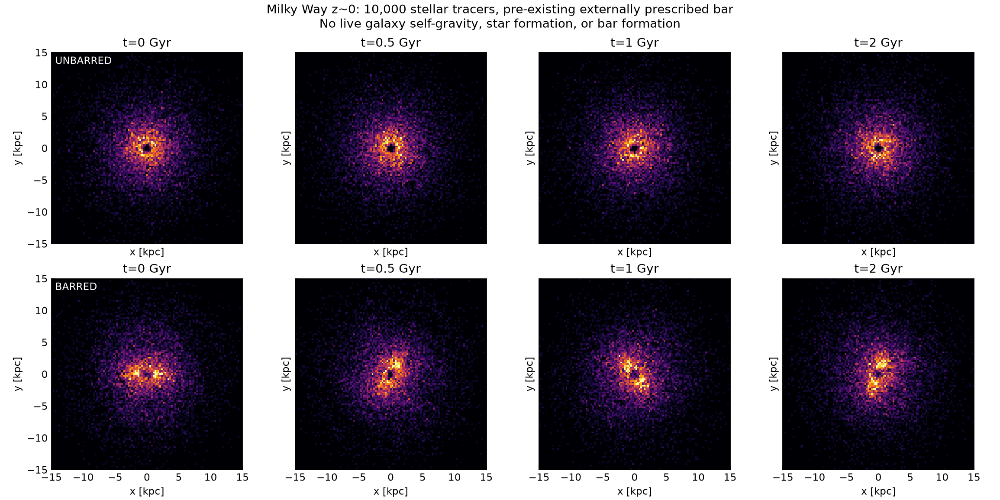
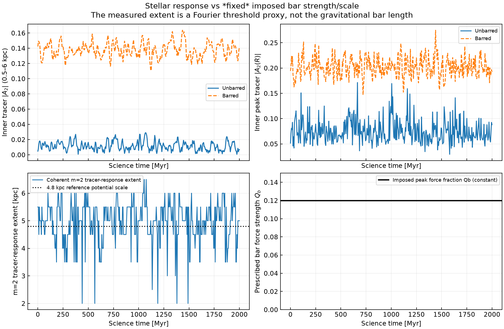
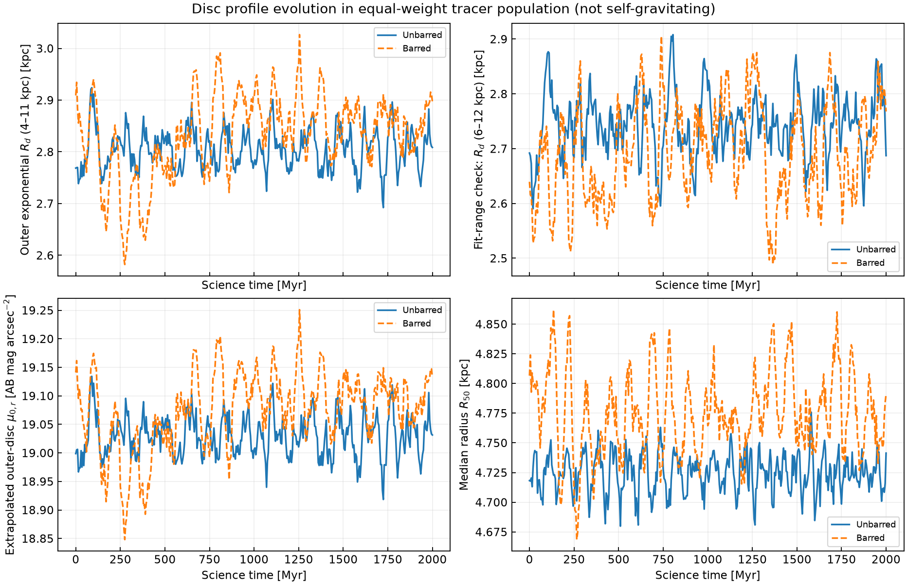
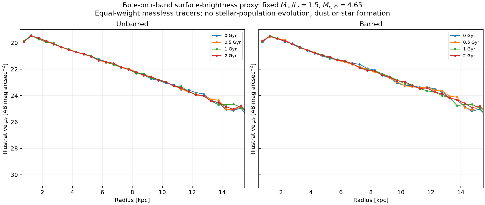
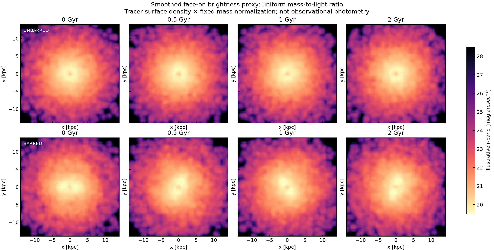
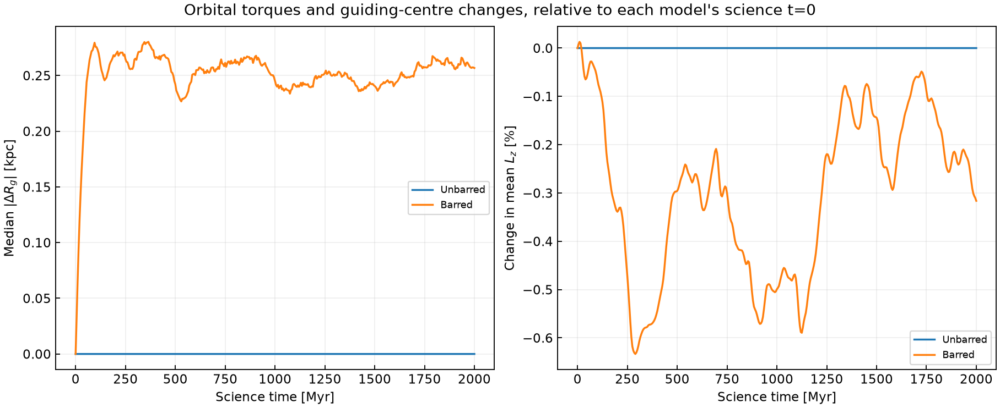
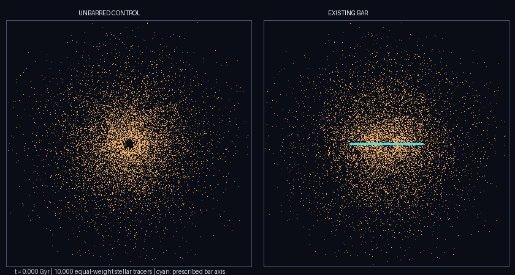
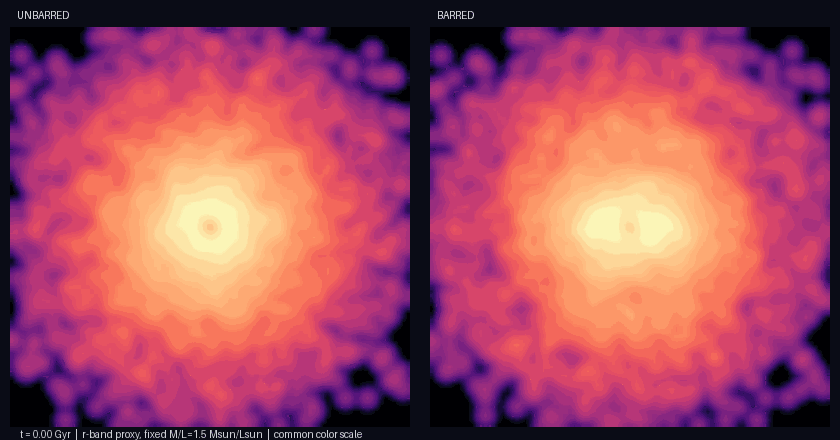

# Version 3 — 2 Gyr of an existing Milky Way-like bar

**Added 6 November 2026.** This is a strict *duration and diagnostics extension* of Version 2. The 300 Myr Version 2 source, summary, GIF and figures in `mwbar/` and `results/` are retained **unchanged**. The original pre-restart experiments remain on [`legacy/v1-2026-11-06`](../../tree/legacy/v1-2026-11-06).

## Experiment

| Quantity | Version 3 |
|---|---|
| Epoch | Milky Way-like galaxy at z ~ 0 |
| Models | Identical pre-science tracer catalogue; unbarred and imposed-bar comparisons |
| Tracers | 10,000 massless, equal-weight stellar orbit samples per model |
| Gravity | **Same Version 2 fixed** Miyamoto–Nagai disc + Hernquist bulge + NFW halo |
| Existing bar | **Same prescribed rotating 3D m=2 quadrupole**; peak $Q_b=0.12$, reference scale 4.8 kpc |
| Bar pattern speed | Constant 39 km s$^{-1}$ kpc$^{-1}$ |
| Preparation | Bar raised smoothly from t=-500 to -200 Myr, then 200 Myr fully established before science t=0 |
| Science duration | **0–2,000 Myr (2 Gyr)**; about 12.7 imposed bar rotations |
| Leapfrog step | 0.25 Myr |
| Stored epochs | Every 5 Myr, **401 snapshots per model** |
| Random seed | 2026 (same as Version 2) |

### What is and is not being measured

- **Imposed bar strength and length do not evolve.** The amplitude of the external perturbation, reference length (a model parameter, not a sharp edge), and pattern speed are fixed throughout the science interval. The *stellar-tracer response* can change over 2 Gyr.
- **Tracer bar strength:** $A_2=|\sum_j e^{2i\phi_j}|/N$ inside 0.5–6 kpc, plus the peak **radial** $A_2(R)$ inside 0.75–3.75 kpc. The unbarred sample provides a noise/phase-mixing comparison.
- **Tracer response extent:** contiguous 0.5-kpc radial annuli around the inner $A_2(R)$ peak where $A_2>\max(0.08,0.5 A_{2,\rm peak})$, the phase differs from the **prescribed bar axis** by no more than 20°, and each annulus has at least 70 tracers. At least two annuli are required. This is a **threshold-dependent Fourier response extent**, **not** an observed bar length or evolving gravitational-bar length; nondetections are left blank.
- **Disc scalelength:** weighted exponential fit to $\Sigma_\star(R)$ over both **4–11** and **6–12 kpc**. Fits depend on radius, with uncertainty from only 10,000 tracers.
- **Face-on surface brightness (illustrative):** equal-tracer weights scaled to the nominal 5.3×10^10 $M_\odot$ stellar disc; constant $M_\star/L_r=1.5\ M_\odot/L_{r,\odot}$; assumed solar SDSS $r$-band AB magnitude $M_{r,\odot}=4.65$:

  $\mu_r=4.65+21.572-2.5\log_{10}[\Sigma_\star/(1.5\ M_\odot\,\mathrm{pc}^{-2})]$ mag arcsec$^{-2}$.

  This assumes a uniform, time-independent mass-to-light ratio. **It is not synthetic observational photometry** and ignores dust, star formation, stellar population aging and population gradients. With constant mass-to-light ratio, the fitted **brightness scalelength equals the mass-tracer scalelength** by construction.
- **Orbit/torque diagnostics:** guiding radius and mean $L_z$ compared with the V2 science t=0 populations. Inertial energy is checked in the unbarred galaxy, while $E-\Omega_b L_z$ is checked for the constant-speed imposed bar.

## Actual computed figures and GIFs

### Structure and face-on appearance







### Disc stellar brightness proxy







### Animation — actual numerical tracer snapshots





### Machine-readable outputs

- [All physical assumptions, conservation checks and endpoint measurements](results/summary_v3.json)
- [Barred $A_2(R)$, response extent, $R_d$, extrapolated brightness, size and thickness vs time](results/barred_v3_diagnostics.csv)
- [Unbarred comparison diagnostics](results/unbarred_v3_diagnostics.csv)
- [Barred surface-density and brightness radial profiles for every 5 Myr](results/barred_v3_brightness_profiles.csv)
- [Unbarred surface-density and brightness radial profiles for every 5 Myr](results/unbarred_v3_brightness_profiles.csv)

Full particle positions and velocities are generated in `results/barred_orbits.npz` and `results/unbarred_orbits.npz`, excluded from Git because of their size, and available as a GitHub Actions artifact for a limited retention period.

## Run

From the repository root:

```bash
python -m pip install -e .
python -m unittest discover -s tests -v
python -m unittest discover -s v3/tests -v
python -m v3.run --n 10000 --dt 0.25 --end 2000 --warmup 500 --growth 300 --snapshot 5 --seed 2026 --out v3/results
```

**Scientific limits:** No self-gravity, live halo response, dynamical bar slowdown, star formation, gas or evolving mass-to-light ratio. A 2-Gyr tracer orbit experiment can test the response to an imposed bar but cannot demonstrate self-consistent long-term disc evolution. The bar's imposed length/force and pattern speed are fixed by construction. Additional seeds and particle-number/bar-parameter convergence remain necessary for robust physical measurements.

**References for observational/methodological context:** [McMillan 2017](https://doi.org/10.1093/mnras/stw2759), [Portail et al. 2017](https://doi.org/10.1093/mnras/stw2819), [Athanassoula 2003](https://doi.org/10.1046/j.1365-8711.2003.06473.x), [Noguchi 2001](https://doi.org/10.1046/j.1365-8711.2001.04910.x), [Fourier bar-size/phase diagnostics](https://doi.org/10.1093/mnras/stae576).
